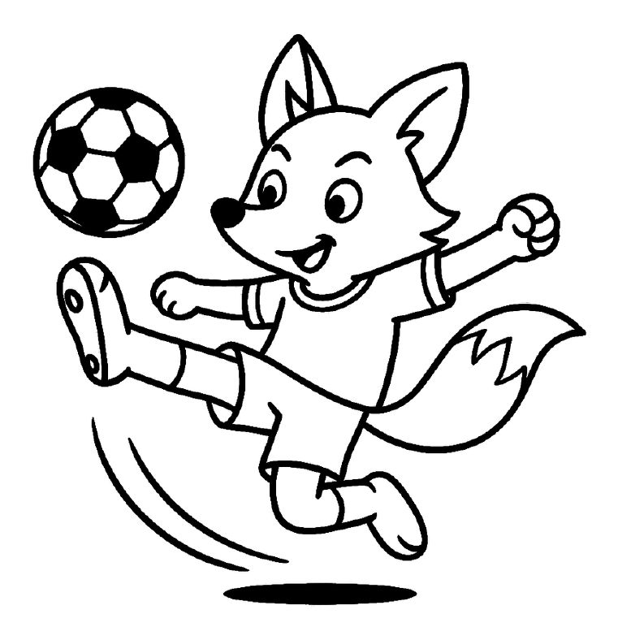
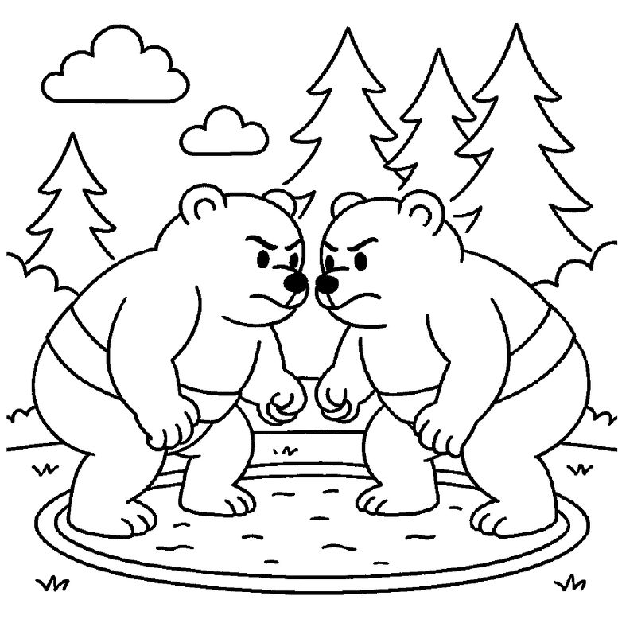
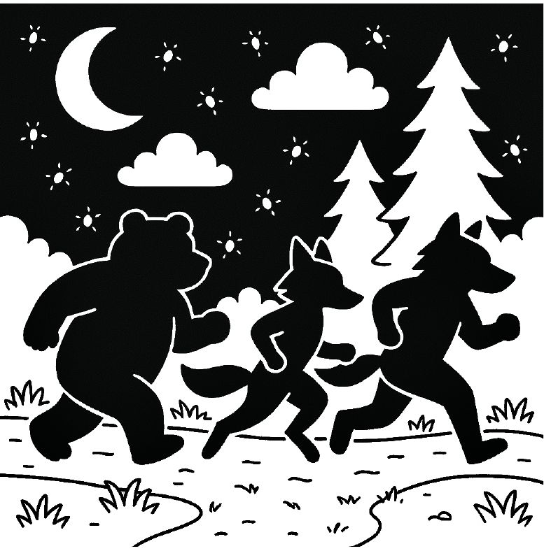
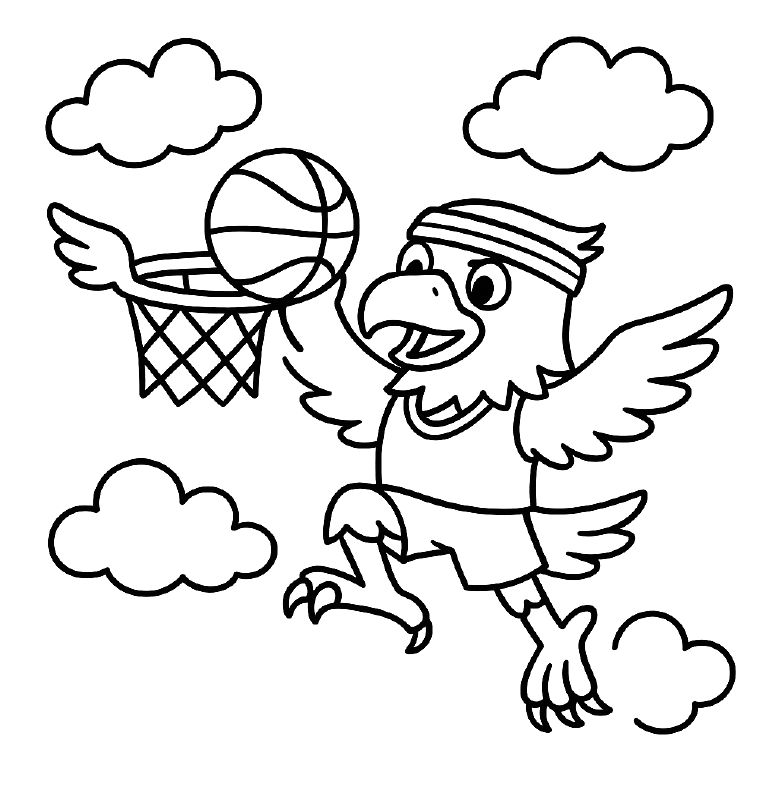
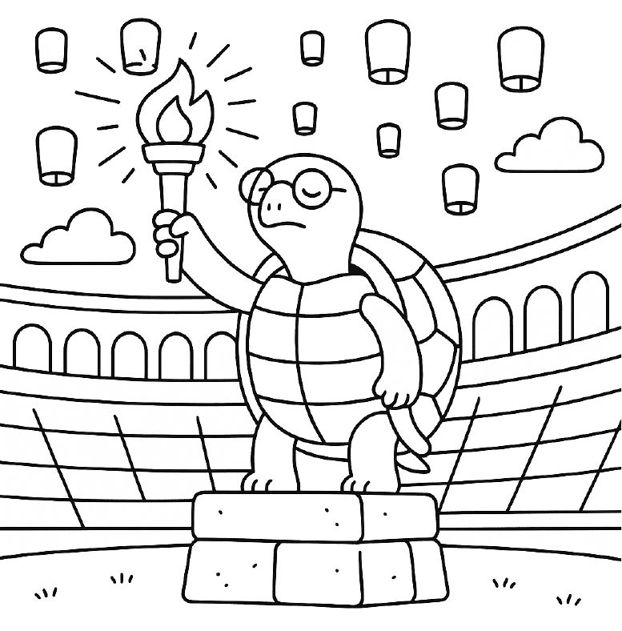

You can print free woodland animal colouring pages of a fox, bears, wolves and an eagle from the free M.J. Artel colouring pack, or colour eight of them online without printing anything. Below, each animal comes with tips for colouring it the way it looks in real life, for kids who like to get it right, and permission to ignore all of them for kids who'd rather make it purple.

All the pages come from *The Wildwood Games*, a story-led colouring book in which four animal teams of the Wildwoods compete in their very own games.

## Where to find the pages

- **To print:** [the free colouring pack](../../free-coloring-pages/) has four Wildwood pages: the opening torch (with Snappy the snapping turtle), a fox playing soccer, all four animals on the team-symbol page, and a trophy.
- **To colour online:** [the Colouring Studio](../../color/#wildwood-29) has eight Wildwood pages, with pencil crayons, wax crayons, watercolours, markers and glitter pens. Pictures save in your browser, so kids can come back to them later.

## The fox

*Fox soccer. [Colour this page online](../../color/#wildwood-29).*

**Real-life colours:** a red fox is a warm, rusty orange, not a bright traffic-cone orange. It has a white chin and chest, a white tip on the end of its tail, and black "socks" on its legs and black on the backs of its ears. A little brown mixed into the orange makes it look more natural.

**Did you know?** A fox's bushy tail helps it balance when it runs and jumps, and keeps its nose warm when it curls up to sleep in winter.

In the book, the Foxes love agility: soccer, the steeplechase and kayaking. There's a [steeplechase fox](../../color/#wildwood-33) to colour online too.

## The bear

*Bear wrestling. [Colour this page online](../../color/#wildwood-45).*

**Real-life colours:** black bears aren't always black. They can be black, brown, cinnamon or even blond, usually with a lighter, tan-coloured muzzle. Grizzly bears are brown with paler tips on their fur, which gives them a slightly silvery look. Try two browns: a dark one for the body and a lighter one on top, where the sun would catch the fur.

**Did you know?** Bears eat a lot of berries, and they will raid beehives for the honey. In the book, the Bears' favourite foods are honeycombs, berries and fresh salmon, and their favourite event is a honeycomb-eating contest.

## The wolf

*The moon-lit marathon, in the book. The wolves also appear on the team-symbol page in the free pack.*

**Real-life colours:** grey wolves are rarely one flat grey. Their coats mix grey with tan, cream, brown and black, with paler bellies and legs and yellow or amber eyes. Layering a light grey over a light brown gets close.

**Did you know?** Wolves live in family groups called packs and work together to hunt and look after their pups. In the book, the Wolves are the fastest runners, and they're at their best in the relay, where the whole team has to work together.

**Tip for dark pages:** the moon-lit marathon is mostly black already. White or glitter gel pens, or a pale wax crayon, make the stars and the runners pop.

## The eagle

*Eagle sky-basketball. [Colour this page online](../../color/#wildwood-23).*

**Real-life colours:** a bald eagle has a dark brown body and wings, a white head and tail, and a bright yellow beak and feet. Young bald eagles are a patchy brown all over; they don't get their white heads until they're about five years old.

**Did you know?** Bald eagles build some of the biggest nests of any bird, and add to them year after year.

## The referee: a snapping turtle

*Snappy lights the opening torch. [Colour this page online](../../color/#wildwood-5).*

Every Wildwood Games is opened by Snappy Snapsalot, the wise old snapping turtle who knows every rule. Real snapping turtles are olive green, brown or muddy grey, often with a little green algae growing on their shells. A watercolour wash in green and brown is perfect for that.

## Or make it your own

Real-life colours are only one way to colour. A purple fox, a rainbow wolf or a bear in the colours of your own sports team are all excellent choices. In the Colouring Studio, the *Wildwood* colour set has the natural forest colours, and the *Classic box* and *Pastels* sets are there for everything else.

If your child enjoys these pages, [The Wildwood Games](../../wildwood-games-coloring-book/) has 37 pictures to colour, each with a page of story.
